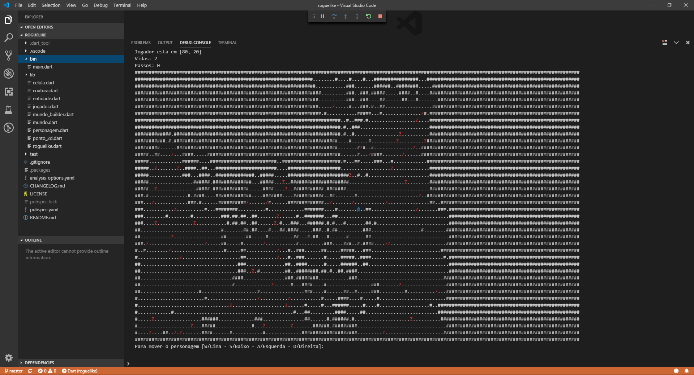

# Roguelike Dart

[](https://dart.dev/get-dart)
[](https://github.com/kleberandrade/roguelike-dart/actions/workflows/dart.yml?query=branch%3Amaster)
[](LICENSE)

An educational, turn-based ASCII roguelike by **Kléber de Oliveira Andrade**.
Originally used in mobile programming classes, the game is written entirely in
Dart and runs in a terminal. It demonstrates inheritance, a world builder,
random-walk dungeon generation and autonomous creatures without a game engine.



## Requirements

- The current stable [Dart SDK](https://dart.dev/get-dart), **3.14.0 or newer,
  below 4.0.0**. Flutter is not required. If using Flutter's bundled Dart,
  check `dart --version` first.
- A terminal at least 80 columns wide, with room for the map and status lines.
  ANSI color is optional and is disabled when output is redirected.
- Network access for the initial development dependency download.

The game has no third-party runtime dependencies. Development uses `lints` and
`test`, with resolved versions committed in `pubspec.lock`.

## Quick start

```sh
git clone https://github.com/kleberandrade/roguelike-dart.git
cd roguelike-dart
dart pub get --enforce-lockfile
dart run bin/main.dart
```

For a reproducible session on the same SDK:

```sh
dart run bin/main.dart --seed 42
dart run bin/main.dart --help
```

Run commands from the repository root. The CLI rejects unsupported arguments
with exit status 64. Quitting, EOF and game over exit normally with status 0.

## Controls and mechanics

Enter one command per line, then press **Enter**. Commands ignore surrounding
whitespace and letter case.

- `W`: up; `A`: left; `S`: down; `D`: right.
- `.`: wait for one turn.
- `Q`: quit. Closing standard input also exits gracefully.

`@` is the player, `Z` a creature, `#` a wall and `.` walkable floor. The default
world is 80 × 24 with 60 creatures and two player lives. A random walk carves
connected passages from the center while retaining the outer walls.

Each accepted movement or wait consumes one turn, including an attempt to walk
into a wall. Invalid input consumes no turn. After the player acts, every
creature randomly waits or attempts a single orthogonal move. A creature that
**ends its move on the player** deals one damage. Creatures can share cells,
including the initial player cell, and each overlapping creature can deal damage.
The player symbol takes priority when rendering shared cells. Lives never fall
below zero; at zero lives the game ends and further world updates are ignored.

This is a small survival teaching demo: there is no victory condition, player
attack, treasure, inventory or save system. The counter reports accepted turns,
not distance traveled. The screen is printed again each turn without clearing
terminal scrollback.

## Examples and library usage

Run the noninteractive example, which builds a small seeded dungeon, renders it,
and advances scripted turns:

```sh
dart run example/seeded_world.dart
```

The original Portuguese class and method names remain available:

```dart
import 'dart:math';
import 'package:roguelike/jogador.dart';
import 'package:roguelike/mundo_builder.dart';
import 'package:roguelike/ponto_2d.dart';

final world = MundoBuilder(20, 10, aleatorio: Random(42))
    .preencher('#', true)
    .criarCaminho(10, 5, 200)
    .criarCriaturas(3)
    .build()
  ..jogador = Jogador(Ponto2D(10, 5), '@', 2);

world.atualizar('w');
print(world.renderizar());
```

The map is indexed as `mapa[x][y]`. Attach a player before updating or rendering
a manually built world. `Mundo.bloqueado` treats out-of-bounds coordinates as
blocked. `renderizar()` returns plain text by default; `desenhar()` prints it.
See [API and extension notes](docs/API.md) for construction contracts and hooks.

## Tests, analysis and build

```sh
dart pub get --enforce-lockfile
dart format --output=none --set-exit-if-changed lib bin example test
dart analyze --fatal-infos
dart test
dart run example/seeded_world.dart
mkdir -p build
dart compile exe bin/main.dart -o build/roguelike
./build/roguelike --seed 42
```

On Windows, create `build` if needed and use `-o build/roguelike.exe`, then run
`build\roguelike.exe --seed 42`. Native executables target the build host's OS and
architecture. Linux and Windows CI run the same checks and a scripted native startup/quit.

The deterministic tests cover connected maps and walls across 20 seeds,
construction errors, creature spawning, movement and boundaries, contact damage,
death, rendering, reproducibility, invalid CLI arguments and EOF/quit behavior.
They test the rules without requiring terminal input or network calls.

## Migration from the original Dart 2 version

See [migration notes](docs/MIGRATION.md) for SDK, API and gameplay changes.
The original entry point remains `bin/main.dart`; use `dart run` rather than the
old direct invocation from `bin/`. `pedantic` was replaced with maintained
`lints`, and the project now uses sound null safety.

## Learning resources and related work

- [Original object-oriented Dart article](https://medium.com/@kleberandrade/orientação-a-objetos-em-dart-16542b792eb9).
- [Masmorra ASCII Dart](https://github.com/kleberandrade/masmorra-ascii-dart) is
  another educational terminal roguelike project by the same author. Its public
  README describes a book, chapter snapshots and a separate final game. It does
  not establish that this repository was renamed or superseded. This repository
  remains an independent, smaller classroom demo and has no dependency on it.

Suggested classroom extensions from the original project: add a docile sheep
(`C`) that flees the player, an aggressive wolf (`L`) that pursues the player,
and a treasure (`G`) awarding 50–100 coins. Display a coin counter and add tests
for each new behavior. These are exercises, not implemented features.

## License

[MIT](LICENSE), copyright (c) 2019 Kléber de Oliveira Andrade. The original
copyright and permission notice are preserved. Third-party dependencies retain
their respective licenses; no source from the related project is bundled.
